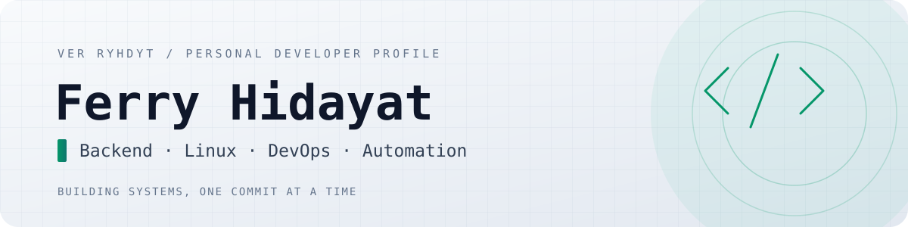

<div align="center">

<picture>
  <source media="(prefers-color-scheme: dark)" srcset="assets/header-dark.svg">
  
</picture>

<br>

<a href="https://github.com/VerryHdyt"></a>
<a href="https://github.com/VerryHdyt?tab=repositories"></a>
<a href="https://github.com/VerryHdyt?tab=followers"></a>

<br><br>


</div>

---

### `01` — about

```text
┌──(ferry㉿verryhdyt)-[~]
└─$ whoami

Name       : Ferry Hidayat
Handle     : VerryHdyt
Education  : Informatics Engineering — Universitas Banten Jaya
Focus      : Backend • Linux • DevOps • Automation
Mindset    : Learn continuously, build deliberately.
```

I'm an Informatics Engineering student who enjoys understanding how software works behind the scenes. I build projects to strengthen my skills in backend development, databases, Linux environments, and system tooling.

- Building practical tools and backend-focused projects.
- Exploring Linux, shell scripting, and system administration.
- Learning CI/CD workflows and developer automation.
- Interested in clean code, useful documentation, and open source.

### `02` — current focus

<table>
  <tr>
    <td width="50%">
      <strong>⚙️ Backend engineering</strong><br>
      <sub>APIs, application logic, PHP, Laravel, and SQL databases.</sub>
    </td>
    <td width="50%">
      <strong>🐧 Linux & systems</strong><br>
      <sub>Shell scripting, CLI utilities, system inspection, and troubleshooting.</sub>
    </td>
  </tr>
  <tr>
    <td width="50%">
      <strong>♾️ DevOps foundations</strong><br>
      <sub>Git, GitHub Actions, CI workflows, and repeatable development.</sub>
    </td>
    <td width="50%">
      <strong>🧪 Problem solving</strong><br>
      <sub>Python, data analysis, algorithms, and hands-on experiments.</sub>
    </td>
  </tr>
</table>

### `03` — technical stack

<div align="center">

**Languages & backend**


**Systems & tools**


</div>

### `04` — selected projects

| Project | What it does | Technology |
|:--|:--|:--|
| [**linux-system-inspector**](https://github.com/VerryHdyt/linux-system-inspector) | Read-only Linux system diagnostics with an animated CLI interface | Bash |
| [**nightcheck**](https://github.com/VerryHdyt/nightcheck) | Lightweight HTTP security-header checker | JavaScript |
| [**Random-Forest-Clasifier**](https://github.com/VerryHdyt/Random-Forest-Clasifier) | Random Forest classification experiment | Python / Jupyter |
| [**DesicionTreeC4.5**](https://github.com/VerryHdyt/DesicionTreeC4.5) | C4.5 decision-tree implementation | Python / Jupyter |
| [**Tugas-Akhir-Dicoding-Pemrograman-Web-Dasar-**](https://github.com/VerryHdyt/Tugas-Akhir-Dicoding-Pemrograman-Web-Dasar-) | Web programming fundamentals project | HTML / CSS |

<div align="right">
  <sub><a href="https://github.com/VerryHdyt?tab=repositories">Explore all repositories →</a></sub>
</div>

### `05` — GitHub telemetry

<div align="center">

<picture>
  <source media="(prefers-color-scheme: dark)" srcset="https://github-readme-stats.vercel.app/api?username=VerryHdyt&show_icons=true&hide_border=true&bg_color=0d1117&title_color=34d399&icon_color=34d399&text_color=cbd5e1&rank_icon=github">
  
</picture>
<picture>
  <source media="(prefers-color-scheme: dark)" srcset="https://github-readme-stats.vercel.app/api/top-langs/?username=VerryHdyt&layout=compact&hide_border=true&bg_color=0d1117&title_color=34d399&text_color=cbd5e1">
  
</picture>

<br>

<picture>
  <source media="(prefers-color-scheme: dark)" srcset="https://github-readme-streak-stats.herokuapp.com?user=VerryHdyt&theme=dark&hide_border=true&background=0D1117&ring=34D399&fire=34D399&currStreakLabel=34D399">
  
</picture>

<br>

<picture>
  <source media="(prefers-color-scheme: dark)" srcset="https://github-readme-activity-graph.vercel.app/graph?username=VerryHdyt&bg_color=0d1117&color=cbd5e1&line=34d399&point=ffffff&area=true&hide_border=true&custom_title=CONTRIBUTION%20ACTIVITY">
  
</picture>

</div>

### `06` — currently learning

```bash
$ cat learning-roadmap.txt
[ in progress ]  Linux internals & shell scripting
[ in progress ]  Backend architecture & API design
[ in progress ]  CI/CD and infrastructure fundamentals
[ next         ]  Containerization & deployment workflows
```

### `07` — connect

<div align="center">

<a href="https://github.com/VerryHdyt"></a>

<sub>Thanks for stopping by. Feel free to explore my repositories and follow the journey.</sub>

<br><br>


</div>
